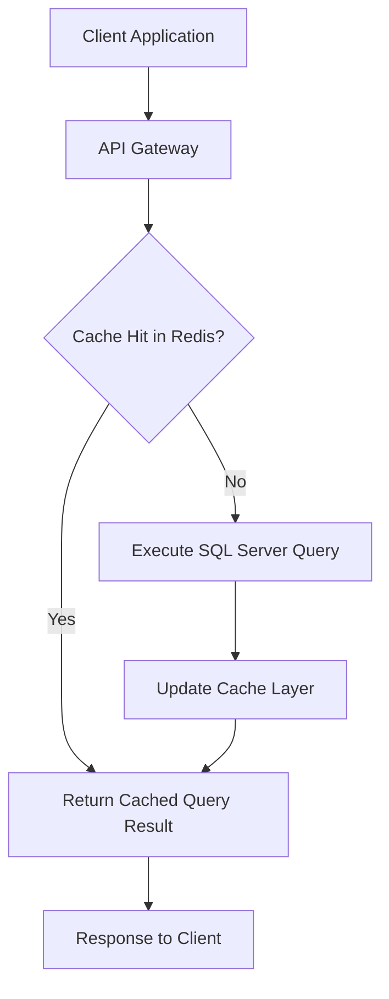

# Managing SQL Server Databases and Query Optimization

> **Purpose:** This reference guide demonstrates standard, RAG-optimized Markdown formatting. It contains all canonical patterns required for semantic chunking, heading breadcrumbs, table preservation, FAQ pairing, flowchart indexing, and video timestamp navigation.

---

## 1. Overview

Relational databases require disciplined indexing, memory caching, and query optimization to maintain low latency under concurrent enterprise workloads. In technical documentation for RAG systems, using clean Markdown outlines ensures that text splitters chunk paragraphs into meaningful, self-contained sections.

Key architectural concepts include:

- **Query Execution Plans:** The graphical or textual roadmap that the SQL Server query optimizer uses to execute queries.
- **Index Seek vs. Index Scan:** Index seeks navigate B-trees to retrieve specific rows; index scans read entire tables or index partitions.
- **Buffer Pool Management:** In-memory caching layer reducing costly physical disk reads.

---

## 2. Prerequisites

Before executing database optimization procedures, ensure the following requirements are met:

- **Software:** SQL Server 2019+ and SQL Server Management Studio (SSMS) 19.x or higher.
- **Permissions:** `sysadmin` or `db_owner` permissions on the target database instance.
- **Network:** Unrestricted TCP access on port `1433` and SQL Server Browser UDP port `1434`.
- **Estimated time:** 20 minutes.

---

## 3. Step-by-Step Procedure: Creating and Tuning a Database

**Goal:** Create a high-throughput orders database, apply nonclustered covering indexes, and configure query performance baselines.

**Expected result:** The database is created, indexes are active, and query execution times remain below 15 milliseconds.

### Step 1 - Connect to the SQL Server instance

**Video:** [00:45 - Connect to Server](https://www.youtube.com/watch?v=dQw4w9WgXcQ&t=45s)

Open SQL Server Management Studio on your workstation. In the **Connect to Server** dialog box, select `Database Engine` as the server type, provide the hostname or IP address, and choose **Windows Authentication** or **SQL Server Authentication**.

Click **Connect** to initialize the management session.

### Step 2 - Execute the database creation script

**Video:** [02:15 - Run Creation Script](https://www.youtube.com/watch?v=dQw4w9WgXcQ&t=135s)

Open a new query editor window and execute the following DDL script to create the database with optimized initial size and file growth parameters:

```sql
CREATE DATABASE CustomerOrders
ON PRIMARY (
    NAME = 'CustomerOrders_Data',
    FILENAME = 'D:\SQLData\CustomerOrders_Data.mdf',
    SIZE = 100MB,
    MAXSIZE = UNLIMITED,
    FILEGROWTH = 64MB
)
LOG ON (
    NAME = 'CustomerOrders_Log',
    FILENAME = 'L:\SQLLog\CustomerOrders_Log.ldf',
    SIZE = 50MB,
    MAXSIZE = 10GB,
    FILEGROWTH = 32MB
);
```

**Expected result:** The database is provisioned and appears in the SSMS Object Explorer.

### Step 3 - Create covering indexes for critical queries

**Video:** [04:00 - Create Covering Index](https://www.youtube.com/watch?v=dQw4w9WgXcQ&t=240s)

To eliminate expensive table scans on high-frequency queries, create a nonclustered composite index with included columns:

```sql
CREATE NONCLUSTERED INDEX IX_Orders_CustomerId_Status
ON dbo.Orders (CustomerId, OrderStatus)
INCLUDE (OrderDate, TotalAmount);
```

```python
import psycopg2

def verify_connection(host, dbname, user):
    """Verify that the database instance accepts client connections."""
    conn = psycopg2.connect(host=host, dbname=dbname, user=user, password="<DATABASE_PASSWORD>")
    cur = conn.cursor()
    cur.execute("SELECT 1;")
    result = cur.fetchone()
    cur.close()
    conn.close()
    return result[0] == 1
```

> **Note:** Including non-key columns in composite indexes satisfies queries directly from the index tree without performing secondary key lookups against the base table.

---

## 4. Query Caching and Execution Lifecycle

Visual architecture diagrams in RAG documents must always be paired with descriptive text so vector retrieval models have semantic tokens to embed.

### 4.1 Request Routing Flowchart (Mermaid)



**Text description:** The flowchart shows the query caching lifecycle. Client requests reach the API gateway, which checks the cache layer first. If cached, the result returns instantly; otherwise, the request executes against SQL Server, updates the cache, and returns the response.

---

## 5. Configuration Reference Table

The following table lists recommended buffer configuration parameters for enterprise workloads:

| Parameter Name | Recommended Value | Data Type | Production Notes |
|---|---|---|---|
| `max server memory` | 80% Total RAM | Integer (MB) | Prevents SQL Server from starving the OS memory. |
| `cost threshold for parallelism` | 50 | Integer | Prevents trivial queries from generating parallel overhead. |
| `max degree of parallelism` | 8 | Integer | Sets maximum cores allocated to a single query execution. |
| `optimize for ad hoc workloads` | 1 | Boolean (0 or 1) | Reclaims plan cache bloat from single-use SQL statements. |

---

## 6. Frequently Asked Questions

### Q: How do I verify that the database was created successfully?

**A:** Open SQL Server Management Studio (SSMS), expand the Databases folder in the Object Explorer, and verify that `CustomerOrders` appears in the list with a normal database icon. You can also run `SELECT name, state_desc FROM sys.databases WHERE name = 'CustomerOrders';` to confirm state `ONLINE`.

### Q: What is the difference between WHERE and HAVING clauses?

**A:** The `WHERE` clause filters individual records before any grouping or aggregate functions are calculated. The `HAVING` clause filters summarized groups after the `GROUP BY` aggregation has completed.

### Q: Why should video timestamp links include seconds in the URL?

**A:** YouTube URL parameters require `&t=SECONDSs` (for example, `02:15` must be formatted as `&t=135s`). This allows deep-linking readers directly to the relevant instructional timestamp in video media.

---

## 7. Troubleshooting Common Database Issues

### Issue 1 - Connection Timeout Expired

- **Symptom:** Client connection fails with error message `Timeout expired. The timeout period elapsed prior to completion of the operation or the server is not responding`.
- **Cause:** SQL Server Browser service is stopped, TCP/IP protocol is disabled in SQL Server Configuration Manager, or port `1433` is blocked by an intermediate firewall.
- **Fix:** Enable TCP/IP in SQL Server Configuration Manager, restart the SQL Server service, and add an inbound firewall exception for TCP port `1433`.

### Issue 2 - High CPU Utilization Due to Index Scans

- **Symptom:** Server CPU reaches 100% during peak order query execution windows.
- **Cause:** Missing indexes cause query engine to execute full clustered index scans across multi-million row tables.
- **Fix:** Review Missing Index DMVs (`sys.dm_db_missing_index_details`) and deploy covering nonclustered indexes for the predicate filter columns.
