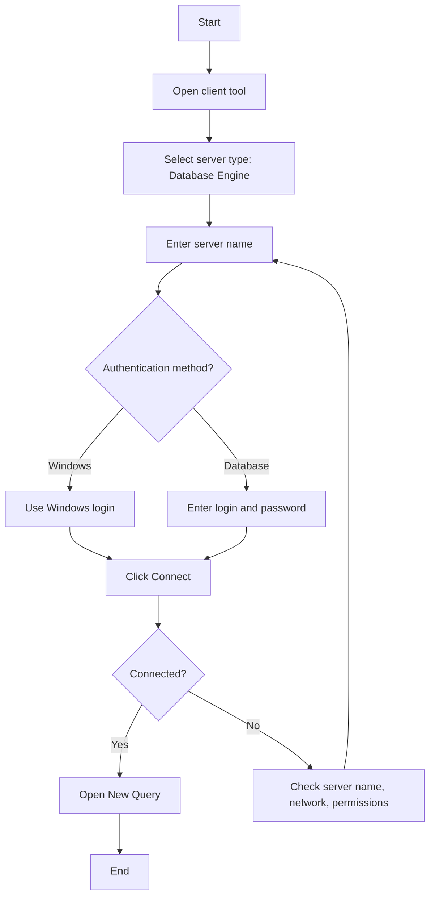
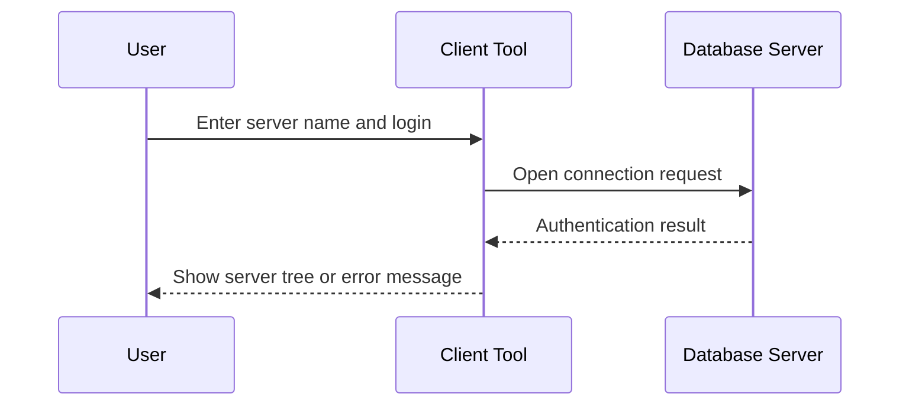
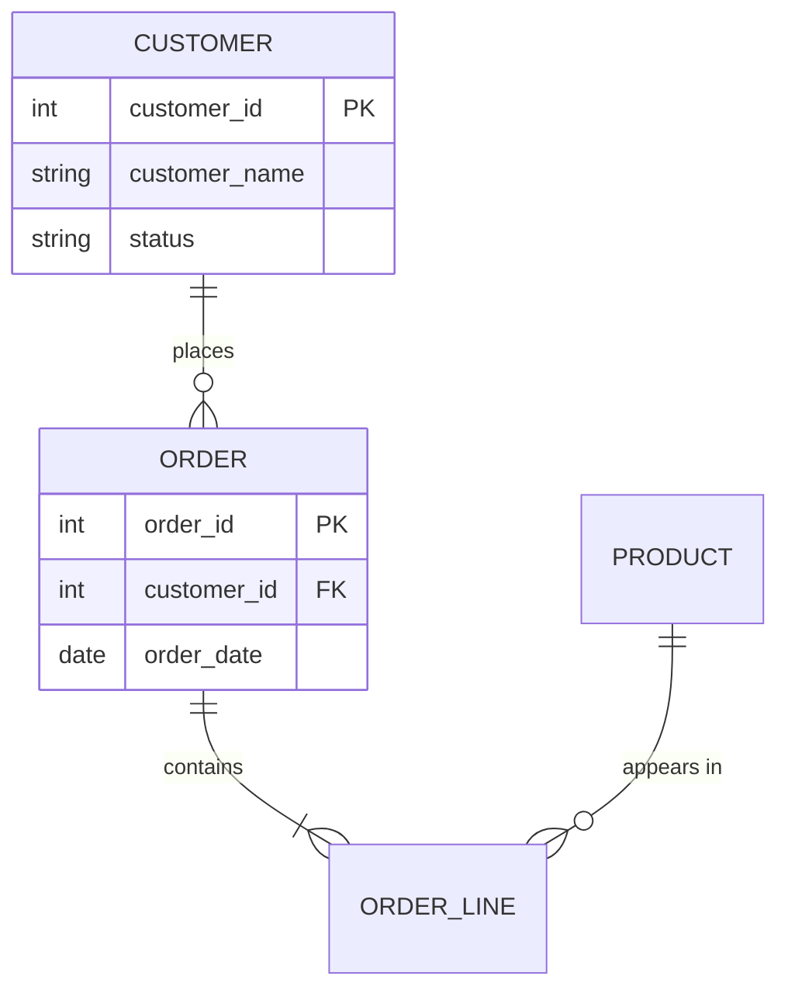
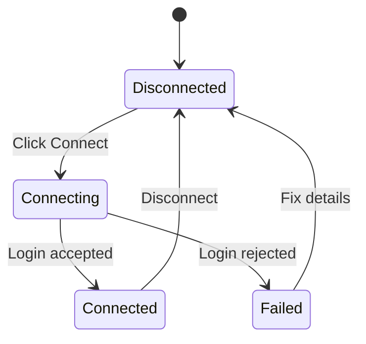
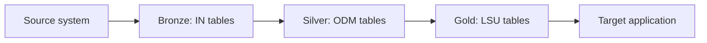

# Master Template - Connecting to a Database Using a Client Tool

> **Purpose:** This is a reference template showing every Markdown pattern commonly used in a RAG knowledge base: source links, YouTube timestamps, procedures, flowcharts, code, tables, callouts, FAQs, troubleshooting, and metadata. Copy the sections you need and delete the rest.
>
> **Important:** All URLs, IDs, server names, and values in this file are placeholders. Replace `VIDEO_ID`, `PLAYLIST_ID`, `SOURCE_FILE_ID`, and the example.com links with real values before use.

**Summary:** This tutorial shows beginners how to connect to a database server using a client tool. It covers choosing the server type, entering the server name, selecting an authentication method, and opening a query editor.

The client tool is not the database itself. The database usually runs on a dedicated server, and developers connect to it from their own machines.

---

## 1. Overview

**Also known as:** SSMS, management studio, SQL client, connect to server

**Key concepts**

| Term | Definition |
|---|---|
| Connect to a Server | Open a session between the client tool and a database server |
| Select Authentication | Choose Windows Authentication or Database (SQL) Authentication |
| Open a Query Editor | Open a window to write and run SQL after the connection succeeds |

**When to use this:** You need to run queries against a database server from your own computer.

**When not to use this:** The data is processed directly in a data lake using code. No client tool connection is needed.

## 2. Prerequisites

Before you start, make sure you have:

- **Software**
  - Client tool installed on your machine
  - Network access to the database server
    - Office network, or
    - VPN if working remotely
- **Access**
  - Server name or IP address
  - Login and password (only for database authentication)
- **Roles:** Admin, DataAdmin
- **Estimated time:** 15 minutes

## 3. Step-by-Step Procedure with Video Timestamps

**Goal:** Connect to the database server using the client tool and open a query editor.

**Navigation path:** Start > All Programs > Database Folder > Client Tool

**Source:** [Connecting to a Database - Part 1](https://www.youtube.com/watch?v=VIDEO_ID&list=PLAYLIST_ID&index=3)

Use the timestamp links in each step to open the video at the exact moment. The written instructions are complete on their own if links do not render.

**Timestamp rule:** YouTube timestamps use seconds in the URL. `03:00` equals `180` seconds, so the URL uses `&t=180s`. For times over one hour, convert `01:05:30` to `3930` seconds.

> **Rule:** Never invent a source URL. If a URL is a placeholder, label it as a placeholder.

### Step 1 - Open the Start menu

**Video:** [00:32 - Click Start](https://www.youtube.com/watch?v=VIDEO_ID&t=32s)

Go to the Start menu at the bottom-left corner of your Windows PC.

**Expected result:** The Start menu appears.

### Step 2 - Select All Programs

**Video:** [00:35 - Select All Programs](https://www.youtube.com/watch?v=VIDEO_ID&t=35s)

Click **All Programs** in the menu window.

**Expected result:** The installed program list is displayed.

### Step 3 - Select the installed database version

**Video:** [00:36 - Select database version](https://www.youtube.com/watch?v=VIDEO_ID&t=36s)

Open the folder that matches the installed database version, for example 2008 or 2008 R2.

**Note:** These are legacy versions used in the tutorial. This is not a recommendation to install an outdated version.

### Step 4 - Open the client tool

**Video:** [00:55 - Open the client tool](https://www.youtube.com/watch?v=VIDEO_ID&t=55s)

Under the version folder, click the client tool. The **Connect to Server** window appears.

**Explanation:** The client tool is not the database server itself. Developers connect to the server from their own computers.

**Diagram:** [Developer machines connecting to a database server](https://example.sharepoint.com/:i:/s/Team/IMAGE_ID)

### Step 5 - Select the server type

**Video:** [03:00 - Select Database Engine](https://www.youtube.com/watch?v=VIDEO_ID&t=180s)

In the **Connect to Server** window, set **Server type** to `Database Engine`.

Other server types you may see:

- Analysis Services
- Reporting Services
- Integration Services

**Server type:** Database Engine

### Step 6 - Enter the server name

**Video:** [03:50 - Specify the server name](https://www.youtube.com/watch?v=VIDEO_ID&t=230s)

Enter the server name or IP address.

- For a local server, use one of these values:
  - `(local)`
  - `.` (a period)
  - `127.0.0.1`
- For a remote server, use the host name or IP address given by your administrator.

**Example server name:** `(local)`

> **Important:** These local values are examples. A remote database needs the real server name and network access.

### Step 7 - Select the authentication method

**Video:** [05:10 - Select Authentication](https://www.youtube.com/watch?v=VIDEO_ID&t=310s)

Choose one option:

1. **Windows Authentication**
   - No separate username or password is needed.
   - Your Windows login and permissions are used.
2. **Database (SQL) Authentication**
   - Enter the login and password.
   - Use this when your administrator gave you a dedicated login.

> **Note:** The options you see depend on how the server was configured. If mixed mode was not enabled during installation, only Windows Authentication may be available.

> **Warning:** Do not store real passwords, tokens, or secrets in documentation or RAG datasets.

### Step 8 - Connect to the server

Click **Connect**.

**Expected result:** The server opens in the client tool. If the connection fails, check the server name, network connection, authentication method, and permissions. See Section 11.

### Step 9 - Open a query editor

**Video:** [07:50 - Open New Query](https://www.youtube.com/watch?v=VIDEO_ID&t=470s)

After connecting, click **New Query** at the top-left of the tool. A query editor opens.

**Result:** You are connected and can run queries.

## 4. Video Chapters (Timestamp Index)

| Time | Seconds | Topic | Link |
|---|---:|---|---|
| 00:32 | 32 | Click Start | [Open at 00:32](https://www.youtube.com/watch?v=VIDEO_ID&t=32s) |
| 00:35 | 35 | Select All Programs | [Open at 00:35](https://www.youtube.com/watch?v=VIDEO_ID&t=35s) |
| 00:55 | 55 | Open the client tool | [Open at 00:55](https://www.youtube.com/watch?v=VIDEO_ID&t=55s) |
| 03:00 | 180 | Select server type | [Open at 03:00](https://www.youtube.com/watch?v=VIDEO_ID&t=180s) |
| 03:50 | 230 | Server name | [Open at 03:50](https://www.youtube.com/watch?v=VIDEO_ID&t=230s) |
| 05:10 | 310 | Authentication | [Open at 05:10](https://www.youtube.com/watch?v=VIDEO_ID&t=310s) |
| 07:50 | 470 | New Query | [Open at 07:50](https://www.youtube.com/watch?v=VIDEO_ID&t=470s) |

## 5. Procedure Without Video (Application Navigation Style)

**Goal:** Include a table from a reference model into a project in a configuration tool.

**Navigation path:** **Configurator** > **Data Models & Maps** > **Model Explorer** > **Home**

**Role:** Integration Consultant | **Estimated time:** 30 minutes

### Procedure

1. Sign in to the tenant and open the **Configurator** workspace.
2. Click the **Page Menu** icon at the top left.
3. Navigate to **Data Models & Maps** and select **Model Explorer**.
   - **Expected result:** The Home screen shows the model and the tables of the current project.
4. In the Filter Pane, set:
   - **Table Type:** `All`
   - **Version:** `CurrentWorkingView`
   - **Project Name:** the intended project
5. Select **Table List** from the Home dropdown.
   - **Expected result:** Two widgets are stacked: tables on top, details of the selected table below.
6. Open the **Tables Excluded** tab.
7. Click the **Filter** icon next to the Table Name column and select the required tables.
8. Select the checkbox for each table, then click **Include Tables**.
9. Close the confirmation popup and open **Tables Included** to verify.
10. Publish the project to validate the inclusion.

**Result:** The table is included with all its columns.

**Tip:** Select the checkbox against each table in **Tables Excluded** before moving to **Tables Included**. Without it, the table is not included.

**Scope note:** This procedure applies only to the tool described in the source. It is not a generic procedure for other products.

### Validation checklist

- [ ] The table appears in the **Tables Included** tab.
- [ ] The project publishes without errors.
- [ ] Column names have no leading or trailing spaces.

### Rollback

1. Open **Tables Included**.
2. Select the table and click **Exclude Tables**.
3. Publish the project again.

## 6. Flowcharts and Diagrams

> **Why every diagram needs a text version:** A RAG system indexes text. A rendered diagram or image is not readable by the retriever. Always add a numbered text description under each diagram so the information can be found and quoted.

### 6.1 Flowchart (Mermaid) - connection process



**Text description of the flowchart:**

1. Start and open the client tool.
2. Select the server type `Database Engine`.
3. Enter the server name.
4. Decide the authentication method:
   - If Windows, use the Windows login.
   - If Database, enter the login and password.
5. Click **Connect**.
6. If connected, open **New Query** and finish.
7. If not connected, check the server name, network, and permissions, then return to step 3.

### 6.2 Decision tree as a table

| Question | If yes | If no |
|---|---|---|
| Is the server on your own machine? | Use `(local)` as the server name | Use the host name or IP from your administrator |
| Does the server allow Windows Authentication? | Choose Windows Authentication | Choose Database Authentication |
| Is a VPN required? | Connect to the VPN first | Continue to Connect |

### 6.3 Sequence diagram (Mermaid)



**Text description:** The user enters the server name and login in the client tool. The tool sends a connection request to the server. The server returns an authentication result. The tool then shows the server tree on success or an error message on failure.

### 6.4 Entity relationship diagram (Mermaid)



**Text description:** One customer places many orders. One order contains one or more order lines. One product can appear in many order lines. `customer_id` is the primary key of CUSTOMER and a foreign key in ORDER.

### 6.5 State diagram (Mermaid)



**Text description:** The connection starts as Disconnected. Clicking Connect moves it to Connecting. It becomes Connected if the login is accepted or Failed if rejected. A Failed connection returns to Disconnected after the details are fixed.

### 6.6 Data pipeline flow (Mermaid, left to right)



**Text description:** Data flows from the source system to Bronze (IN tables), then Silver (ODM tables), then Gold (LSU tables), and finally to the target application.

### 6.7 Plain-text (ASCII) diagram

Use this when Mermaid does not render.

```text
+-----------+     +---------------+     +-----------------+
| Developer | --> |  Client Tool  | --> | Database Server |
|  Machine  |     |   (SSMS)      |     |  (Dedicated)    |
+-----------+     +---------------+     +-----------------+
```

**Text description:** A developer machine uses the client tool to connect to a dedicated database server.

### 6.8 Image with alt text


**Image note:** The URL above is a placeholder. Always write alt text that explains what the image shows. The image itself is not indexed as text.

### 6.9 How to create these diagrams

- **Mermaid:** Write the diagram as text inside a code fence marked `mermaid`. Preview at [mermaid.live](https://mermaid.live). Supported types include `flowchart`, `sequenceDiagram`, `erDiagram`, `stateDiagram-v2`, `gantt`, and `classDiagram`.
- **Flowchart basics:**
  - `A[Text]` is a box.
  - `B{Question?}` is a decision diamond.
  - `A --> B` is an arrow.
  - `A -->|label| B` is an arrow with a label.
  - `TD` means top-down and `LR` means left-to-right.
- **Other tools:** draw.io, Lucidchart, or Visio. Export as PNG and insert with the image syntax above, then add a text description.
- **Rule:** Keep the text description next to every diagram.

## 7. Code Examples and Technical Structures

Inline code uses backticks, for example `SELECT`, `Database Engine`, `CurrentWorkingView`, and `HTTP 401`.

### 7.1 SQL - query

**Video:** [08:20 - Run a test query](https://www.youtube.com/watch?v=VIDEO_ID&t=500s)

```sql
SELECT TOP 10
    customer_id,
    customer_name,
    status
FROM dbo.sample_customers
WHERE status = 'ACTIVE'
ORDER BY customer_name;
```

**Purpose:** Return the first 10 active customers ordered by name.

### 7.2 SQL - join and aggregate

```sql
SELECT
    c.customer_name,
    COUNT(o.order_id) AS order_count,
    SUM(o.total_amount) AS total_amount
FROM dbo.sample_customers AS c
INNER JOIN dbo.sample_orders AS o
    ON o.customer_id = c.customer_id
WHERE o.order_date >= '2026-01-01'
GROUP BY c.customer_name
HAVING COUNT(o.order_id) > 5
ORDER BY total_amount DESC;
```

**Purpose:** Show customers with more than five orders in 2026, highest total first.

### 7.3 SQL - create table (DDL)

```sql
CREATE TABLE dbo.sample_customers (
    customer_id   INT           NOT NULL PRIMARY KEY,
    customer_name NVARCHAR(200) NOT NULL,
    status        VARCHAR(20)   NOT NULL DEFAULT 'ACTIVE',
    created_date  DATETIME      NOT NULL DEFAULT GETDATE()
);
```

| Column | Type | Nullable | Default | Notes |
|---|---|---|---|---|
| customer_id | INT | No | None | Primary key |
| customer_name | NVARCHAR(200) | No | None | Full customer name |
| status | VARCHAR(20) | No | `ACTIVE` | `ACTIVE` or `INACTIVE` |
| created_date | DATETIME | No | `GETDATE()` | Set automatically |

### 7.4 SQL - insert, update, delete (DML)

```sql
INSERT INTO dbo.sample_customers (customer_id, customer_name)
VALUES (101, 'Example Customer');

UPDATE dbo.sample_customers
SET status = 'INACTIVE'
WHERE customer_id = 101;
```

> **Warning:** Always include a `WHERE` clause with `UPDATE` and `DELETE`. Test on a non-production database first.

### 7.5 SQL - CTE and stored procedure

```sql
WITH recent_orders AS (
    SELECT customer_id, MAX(order_date) AS last_order_date
    FROM dbo.sample_orders
    GROUP BY customer_id
)
SELECT c.customer_name, r.last_order_date
FROM dbo.sample_customers AS c
JOIN recent_orders AS r ON r.customer_id = c.customer_id;
```

```sql
CREATE PROCEDURE dbo.usp_get_active_customers
    @min_id INT = 0
AS
BEGIN
    SELECT customer_id, customer_name
    FROM dbo.sample_customers
    WHERE status = 'ACTIVE' AND customer_id >= @min_id;
END;
```

### 7.6 Python

```python
def normalize_text(value: str) -> str:
    """Normalize whitespace in a text value."""
    return " ".join(value.split())


sample = "  RAG   Markdown   Example  "
print(normalize_text(sample))
```

**Expected output:**

```text
RAG Markdown Example
```

### 7.7 PySpark

```python
from pyspark.sql import SparkSession
from pyspark.sql.functions import col

spark = SparkSession.builder.appName("sample").getOrCreate()

df = spark.read.format("delta").load("/mnt/lake/bronze/in_customers")
active = df.filter(col("status") == "ACTIVE")
active.write.format("delta").mode("overwrite").save("/mnt/lake/silver/odm_customers")
```

**Purpose:** Read a Bronze table, keep active rows, and write the result to Silver.

### 7.8 Shell and PowerShell commands

```bash
# Example commands only; paths depend on the environment.
python --version
git status
ping 10.0.0.25
```

```powershell
Test-NetConnection -ComputerName 10.0.0.25 -Port 1433
```

> **Safety note:** Explain a command before recommending it. Clearly mark destructive commands such as `rm -rf` or `DROP TABLE`.

### 7.9 API request and response

```bash
curl -X POST "https://api.example.com/v1/search" \
  -H "Authorization: Bearer <YOUR_TOKEN>" \
  -H "Content-Type: application/json" \
  -d '{"query": "connect to server", "top_k": 5}'
```

```json
{
  "answer": "Select Database Engine in the Connect to Server window.",
  "sources": [
    {
      "title": "Connecting to a Database - Part 1",
      "url": "https://www.youtube.com/watch?v=VIDEO_ID&t=180s"
    }
  ]
}
```

The response above is a synthetic example. It is not captured from a real API.

### 7.10 JSON, YAML, CSV, and environment files

```json
{
  "document_id": "DOC-001",
  "section": "Step-by-Step Procedure",
  "heading": "Step 5 - Select the server type",
  "timestamp": "03:00",
  "timestamp_seconds": 180,
  "url": "https://www.youtube.com/watch?v=VIDEO_ID&t=180s"
}
```

```yaml
pipeline:
  parse: true
  chunk: true
  embed: true
retrieval:
  mode: hybrid
  top_k: 5
```

```csv
document_id,title,format,contains_timestamp
DOC-001,Connection Tutorial,Markdown,true
DOC-002,Table Procedure,Markdown,false
```

```ini
# .env example - use placeholders, never real secrets
DB_HOST=10.0.0.25
DB_PORT=1433
DB_USER=sample_user
DB_PASSWORD=<set-in-secret-store>
```

### 7.11 Project folder structure

```text
project-root/
├── README.md
├── config/
│   ├── settings.yaml
│   └── connections.json
├── src/
│   ├── main.py
│   └── utils/
│       ├── db.py
│       └── logging.py
├── sql/
│   ├── 001_create_tables.sql
│   └── 002_seed_data.sql
└── tests/
    └── test_db.py
```

| Path | Purpose |
|---|---|
| `config/settings.yaml` | Application settings |
| `src/utils/db.py` | Database connection helper |
| `sql/001_create_tables.sql` | Creates the tables |
| `tests/test_db.py` | Connection tests |

### 7.12 Configuration change (diff)

```diff
- timeout: 30
+ timeout: 60
  retries: 3
```

**Meaning:** The timeout changed from 30 to 60 seconds. Retries stay at 3.

### 7.13 Log excerpt

```text
2026-10-27 10:15:02 INFO  document_parser - Parsing started
2026-10-27 10:15:03 INFO  document_parser - 12 sections extracted
2026-10-27 10:15:04 WARN  chunker - Table spans multiple chunks
2026-10-27 10:15:05 INFO  indexer - Indexing completed
```

**Diagnostic question:** Which component logged a warning?

**Answer:** The chunker logged "Table spans multiple chunks".

### 7.14 Regex and schedule examples

| Item | Example | Meaning |
|---|---|---|
| Regex | `^\d{2}:\d{2}$` | Matches a timestamp such as `03:00` |
| Cron | `0 2 * * 1-5` | Runs at 02:00 on weekdays |

## 8. Reference Tables

### 8.1 Connection fields

| Field | Description | Allowed Values | Default | Notes |
|---|---|---|---|---|
| Server type | Service you connect to | Database Engine, Analysis Services, Reporting Services | Database Engine | Use Database Engine for normal queries |
| Server name | Host name or IP of the server | Text | Blank | Use `(local)` for the same machine |
| Authentication | How you prove your identity | Windows, Database login | Windows | Depends on server configuration |
| Login | Username for database authentication | Text | Blank | Needed only for database authentication |
| Password | Password for the login | Text | Blank | Needed only for database authentication |

### 8.2 Comparison table

| Option | Advantages | Limitations | Example use |
|---|---|---|---|
| Windows Authentication | No password to manage | Needs a domain or Windows account | Corporate network |
| Database Authentication | Works without a domain | Passwords must be managed | External contractors |
| Keyword retrieval | Good for exact names and IDs | Misses semantic matches | Search for an error code |
| Vector retrieval | Finds related meaning | May miss exact IDs | Natural-language question |
| Hybrid retrieval | Combines both | Needs tuning | Technical knowledge base |

### 8.3 Error code table

| Code | Message | Meaning | Fix |
|---|---|---|---|
| 18456 | Login failed for user | Wrong login or authentication mode not allowed | Check login or try Windows Authentication |
| 53 | Network path not found | Server name wrong or server unreachable | Check name, VPN, firewall |
| 4060 | Cannot open database | Database missing or no permission | Ask the administrator for access |

### 8.4 Responsibility table (RACI)

| Task | Developer | Administrator | Manager |
|---|---|---|---|
| Request access | Responsible | Accountable | Informed |
| Grant permission | Informed | Responsible | Accountable |
| Run queries | Responsible | Consulted | Informed |

### 8.5 Numeric values, dates, and units

| Item | Value | Unit or format |
|---|---:|---|
| Example timeout | 30 | seconds |
| Example batch size | 500 | records |
| Example file size | 12.5 | MB |
| Example review date | 2026-10-27 | ISO date |
| Example duration | 00:03:00 | HH:MM:SS |

These are synthetic values, not production measurements.

**Conversion example:** 3 minutes x 60 seconds per minute = 180 seconds.

### 8.6 Formula

`Precision = Relevant Retrieved Results / Total Retrieved Results`

`Recall = Relevant Retrieved Results / Total Relevant Results`

**Example:** If 8 of 10 retrieved passages are relevant, precision is `8 / 10 = 0.80`, or 80%.

## 9. Callouts, Notes, and Status Labels

Always start a callout with a text label. Emoji are optional visual aids and must not be the only signal.

> 🟢 **Tip:** Save the server name as a favorite so you do not have to type it every time.

> 🟡 **Warning:** Do not share your database password in chat or email.

> 🔴 **Important:** Never run `DELETE` or `DROP` statements on a production database without approval.

> 🔵 **Info:** Connection settings differ between development, test, and production servers.

> **Main observation:**
>
> > **Supporting detail:** Retrieved context should contain the evidence needed to answer the question.
>
> **Practical implication:** Test retrieval before changing the prompt.

**Status labels**

- **SUCCESS:** The operation completed successfully.
- **WARNING:** The operation may have an unintended consequence.
- **ERROR:** The operation failed and needs investigation.
- **INFO:** Additional context is provided.
- **PENDING:** The operation has not completed.
- **NOT APPLICABLE:** The step does not apply to this scenario.

**Optional HTML color (display only):** <span style="color: #2563eb;">Blue text for a timestamp</span> and <span style="color: #b45309;">amber text for a caution</span>. Many parsers strip HTML, so the meaning must also be clear in plain text, such as **Warning:** or **Important:**.

## 10. Headings, Paragraphs, and Lists

### 10.1 Heading hierarchy

Use headings to reflect the topic structure. A heading stays associated with the content that follows it.

#### 10.1.1 Fourth-level heading

Use a fourth-level heading for a detailed procedure, configuration subsection, or troubleshooting case.

##### 10.1.1.1 Fifth-level heading

Use deep nesting sparingly.

### 10.2 Paragraphs

A paragraph contains related sentences about one idea. Separate paragraphs with a blank line.

A second paragraph describes the topic from another angle. Short paragraphs help parsers and readers find topic boundaries.

### 10.3 Unordered list

- Collect the source document.
- Parse the file.
- Split the text into chunks.
- Index the chunks.
- Retrieve relevant chunks for a question.

### 10.4 Nested unordered list

- Data ingestion
  - Source systems
    - Relational databases
    - CSV and Excel files
    - PDF and Markdown documents
  - Processing
    - Parsing
    - Validation
    - Deduplication
  - Storage
    - Object storage
    - Relational database
    - Vector index

### 10.5 Ordered list with nested steps

1. Prepare the document.
   - Confirm UTF-8 encoding.
   - Confirm the document has a title.
2. Process the document.
   1. Extract the text.
   2. Preserve the headings.
   3. Preserve links and code blocks.
3. Verify the output.
   - Check that all sections are present.
   - Check that list items are not merged into paragraphs.

### 10.6 Task list

- [x] Create the Markdown document.
- [x] Include a source URL.
- [x] Include timestamp links.
- [ ] Upload the document to a test dataset.
- [ ] Inspect the parsed chunks.
- [ ] Test broad and specific questions.

### 10.7 Definition list (plain Markdown)

**Chunking:** Splitting a document into smaller text units for indexing and retrieval.

**Embedding:** Representing content as a numerical vector for semantic comparison.

**Reranking:** Reordering retrieved candidates by relevance.

**Grounded answer:** An answer supported by retrieved source material.

### 10.8 Long paragraph (context preservation)

Document ingestion is not complete merely because a file upload succeeds. The parser must extract meaningful content, the chunker must keep enough context for a passage to make sense, the embedding and indexing stages must store the content correctly, the retriever must return relevant passages, and the generator must use those passages to answer the question. If any stage fails, the final answer may be incomplete even though the file contains the correct information. For this reason, debugging should follow the data path from source file to parsed text, from parsed text to chunks, from chunks to retrieval results, and from retrieval results to the final response.

## 11. Troubleshooting

### Why can I not connect to the server?

- **Symptom:** The tool shows "Cannot connect to server".
- **Cause:** The server name is wrong, the server is offline, or you are not on the network.
- **Fix:**
  1. Check the server name for typos.
  2. Connect to the VPN if you work remotely.
  3. Ask your administrator to confirm the server is running.

### Why does login fail with a valid password?

- **Symptom:** "Login failed for user".
- **Cause:** Database authentication is not enabled on the server.
- **Fix:**
  1. Try Windows Authentication.
  2. Ask your administrator to enable mixed mode.

### Why do I not see the New Query button?

- **Symptom:** The toolbar has no **New Query** button.
- **Cause:** The connection did not complete, or the toolbar is hidden.
- **Fix:** Confirm you are connected, then open the **View** menu and enable the toolbar.

### Why am I not able to see some tables?

- **Symptom:** The Tables widget shows only some tables.
- **Cause:** Filters on Table Type, Project, Version, or the Table Name column are active.
- **Fix:**
  1. Click the **Filters** icon in the toolbar.
  2. Set the Table Type, Project Name, and Version.
  3. Click the **Column Filter** icon on Table Name and choose **Select All**.

### RAG-specific problems

| Problem | Symptom | Likely cause | How to check |
|---|---|---|---|
| Missing information | Answer omits a step that exists in the source | Section not parsed, split badly, or not retrieved | Search the parsed preview, then inspect retrieved chunks |
| Timestamp not clickable | `03:00` shows as plain text | No URL in the indexed chunk, or the model dropped the link | Check original Markdown, raw model response, rendered chat |
| Table unreadable | Headers separated from rows | Chunker split the table | Inspect chunk previews |
| Source URL missing | Answer names the source but has no link | URL not in the chunk or not reproduced | Check parsed output, retrieved context, raw answer |
| Short answer | Detailed source gives a brief answer | Concise prompt, low token limit, or weak retrieval | Compare retrieved chunks and raw output |

## 12. Frequently Asked Questions

> 🟢 **Tip:** **FAQ Authoring Rules for RAG:**
> - **Question Format:** Every entry must use `### Q: <Question>?` heading format.
> - **Answer Format:** Every answer must begin with `**A:** <Direct answer or lead-in statement>`.
> - **Table Answers:** When an FAQ answer is a table, never place the bare table immediately below the heading. Always provide an `**A:** ...` lead-in statement first (e.g., `**A:** The comparison is summarized below:`).
> - **Code Query Answers:** When providing code or SQL query examples in FAQ, phrase the heading as an inquiry (e.g., `### Q: How do I ...?`) and provide an `**A:** Use the following query:` lead-in line before the code fence.

### Q: Is the client tool the same as the database server?

**A:** No. The client tool is only an interface. The database server runs separately, usually on a dedicated machine.

### Q: Which server type should I choose?

**A:** Choose **Database Engine** for normal database connections and queries.

### Q: Can I connect without a password?

**A:** Yes, if you use Windows Authentication. Your Windows login is used instead.

### Q: What is the difference between Windows Authentication and Database Authentication?

**A:** The comparison between the two authentication modes is summarized below:

| Authentication Mode | Credential Source | Best Used For | Security Benefit |
|---|---|---|---|
| **Windows Authentication** | Windows OS / Active Directory account | Internal corporate workstations and domain members | No database passwords transmitted over the network |
| **Database (SQL) Authentication** | Internal database user table (`sa`, etc.) | External apps, third-party services, non-domain clients | Works across non-trusted network boundaries |

### Q: How do I test the database connection using a SQL query?

**A:** Open the query editor and execute the following query:

```sql
SELECT @@SERVERNAME AS ServerName,
       SYSTEM_USER AS ConnectedUser,
       GETDATE() AS CurrentServerTime;
```

### Q: How can a YouTube timestamp open at a specific moment?

**A:** Add `&t=` and the seconds to the video URL. For example, `https://www.youtube.com/watch?v=VIDEO_ID&t=180s` opens the video at 3 minutes.

### Q: Does adding colors improve retrieval?

**A:** No. Colors affect only display. Retrieval depends on extracted text, chunking, and ranking, so keep important meaning in plain text.

### Q: Should every question get a long answer?

**A:** No. A simple factual question needs one sentence. A procedure needs the essential steps and links.

## 13. Best Practices

- ✅ **Do:** Use Windows Authentication when it is available.
- ✅ **Do:** Use consistent names for saved connections, for example `PROJECT_ENV_SERVER`.
- ✅ **Do:** Put the full URL on every timestamp so each step chunk is self-contained.
- ✅ **Do:** Add a text description under every diagram and image.
- ✅ **Do:** Keep each step short, with the **Expected result** next to it.
- ❌ **Don't:** Share passwords by chat or email.
- ❌ **Don't:** Leave spaces before or after a name. The space becomes part of the name and the lookup fails.
- ❌ **Don't:** Use "click here" as link text. Use descriptive text such as [connection tutorial](https://www.youtube.com/watch?v=VIDEO_ID).
- ❌ **Don't:** Escape Markdown characters (`\*\*`, `\#`) or end lines with `\`.

## 14. Acronyms, Synonyms, and Alternative Names

### 14.1 Acronyms

- **RAG:** Retrieval-Augmented Generation.
- **SSMS:** SQL Server Management Studio.
- **SSAS:** SQL Server Analysis Services.
- **SSRS:** SQL Server Reporting Services.
- **SSIS:** SQL Server Integration Services.
- **EKGC:** EKG Configurator.
- **Top K:** The number of candidate chunks selected.

### 14.2 Alternative names

| Primary term | Alternative terms |
|---|---|
| Client tool | SSMS, management studio, SQL client |
| Server name | Host, instance, data source |
| Include a table | Add table, include table from reference model |
| Source document | Reference file, original document, source file |
| Bronze / Silver / Gold | IN / ODM / LSU tables |

## 15. Glossary

| Term | Definition |
|---|---|
| Client tool | Application used to connect to a database server and run queries |
| Database Engine | Server component that stores, processes, and secures data |
| Windows Authentication | Sign-in that uses your Windows identity |
| Database Authentication | Sign-in that uses a login and password created on the server |
| Query editor | Window where you write and run SQL statements |
| Chunk | A smaller segment of a document used for indexing and retrieval |
| Embedding | A vector representation of text used for semantic search |
| Grounding | Supporting an answer with supplied source evidence |
| Hybrid retrieval | Retrieval that combines keyword and semantic methods |
| Reranking | Reordering retrieved results by relevance |
| Timestamp link | A URL that opens media at a specific time |

## 16. Cross-References, Links, and Footnotes

### 16.1 Links to other sections

- For the video procedure, see [Section 3: Step-by-Step Procedure](#3-step-by-step-procedure-with-video-timestamps).
- For diagrams, see [Section 6: Flowcharts and Diagrams](#6-flowcharts-and-diagrams).
- For code, see [Section 7: Code Examples](#7-code-examples-and-technical-structures).
- For fixes, see [Section 11: Troubleshooting](#11-troubleshooting).

### 16.2 Other link styles

- Plain URL: https://docs.example.com/connect
- Autolink: <https://docs.example.com/connect>
- Email: <support@example.com>
- Reference-style link: [vendor guide][vendor-guide]
- Image that is also a link: [](https://www.youtube.com/watch?v=VIDEO_ID)
- Page reference in a PDF: See page 12 of [Source Guide.pdf](https://example.sharepoint.com/:b:/s/Team/SOURCE_FILE_ID).

[vendor-guide]: https://docs.example.com/connect "Vendor connection guide"

### 16.3 Footnote

The tutorial covers older server versions.[^legacy]

[^legacy]: Legacy versions are shown for demonstration. Use a supported version for new installations.

## 17. Evaluation Questions and Answer Key

Use these questions to test whether the document is retrievable after ingestion.

| # | Question | Expected answer |
|---|---|---|
| 1 | What is the document ID? | `RAG-SAMPLE-MASTER-0001` |
| 2 | Which server type should I select? | `Database Engine` |
| 3 | What URL opens the tutorial at 03:00? | `https://www.youtube.com/watch?v=VIDEO_ID&t=180s` |
| 4 | How many seconds is 03:00? | 180 seconds |
| 5 | What are the authentication choices? | Windows Authentication and Database (SQL) Authentication |
| 6 | What does error 18456 mean? | Login failed for user; check the login or try Windows Authentication |
| 7 | What happens if the connection fails in the flowchart? | Check server name, network, and permissions, then re-enter the server name |
| 8 | What does the chunker warning in the log say? | Table spans multiple chunks |
| 9 | Which tab must you check a box in before clicking Include Tables? | Tables Excluded |
| 10 | Which layer uses IN tables? | Bronze |

## 18. Authoring Checklist (Before Uploading to the RAG App)

- [ ] The file has a stable `doc_id` and a descriptive title.
- [ ] Front matter is valid YAML enclosed by `---`.
- [ ] Heading levels follow the document hierarchy.
- [ ] Every step has its own full URL, not only the video's start link.
- [ ] Timestamps were converted to seconds correctly.
- [ ] Every diagram and image has alt text and a text description.
- [ ] Code fences are opened and closed, and have a language label.
- [ ] Tables have a header row and a separator row.
- [ ] Each procedure shows the goal, steps, expected result, and tips.
- [ ] Troubleshooting entries show symptom, cause, and fix.
- [ ] FAQ entries use '### Q: ...?' heading format and begin answers with '**A:** ...' (including a lead-in line before any table or code block).
- [ ] Code tasks in FAQ are phrased as inquiries (e.g., '### Q: How do I ...?') with '**A:** Use the following query:' before code fences.
- [ ] Placeholder links and sample values are labeled.
- [ ] No passwords, API keys, tokens, or customer data are included.
- [ ] No escaped Markdown characters or trailing backslashes remain.
- [ ] Chunk previews were checked after ingestion.
- [ ] Both broad and specific questions were tested in the app.
